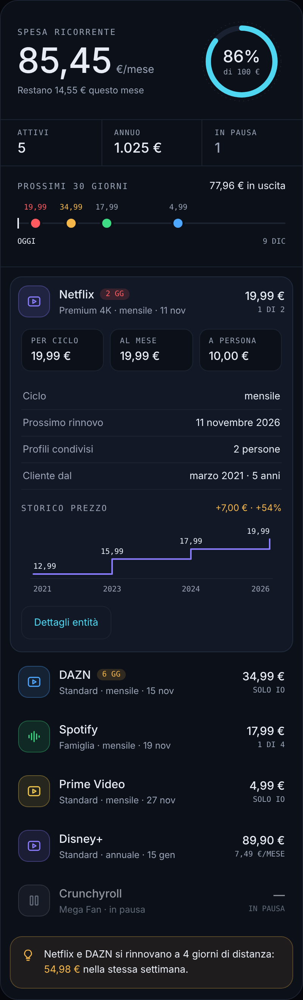

# Subscription Tracker Card

Lovelace card for the [Subscription Tracker](https://github.com/ivp-arch/ha-subscription-tracker) integration.

It shows the total recurring spend, the monthly budget, a 30-day renewal timeline and the list of subscriptions. Tap a row to see the full detail with the price history.



*Orbit theme, rendered with sample data.*

## Installation

### Home Assistant Marketplace (2026.11 or later)
1. Settings → Marketplace → menu (⋮) → **Add from link** (requires connecting a GitHub account)
2. Enter `ivp-arch/ha-subscription-tracker-card`; if asked, choose the **Dashboard** type
3. Install and reload the browser. The resource is added automatically (`/local/community/...`), unless you manage resources in YAML

### HACS (Home Assistant before 2026.11)
HACS → Frontend → menu (⋮) → Custom repositories → add this repo's URL, category **Lovelace**. Install and reload the page.

### Manual
Copy `dist/subscription-tracker-card.js` to `/config/www/`, then add the resource:

Settings → Dashboards → menu (⋮) → Resources → Add (enable advanced mode in your user profile if the menu is missing):
- URL: `/local/subscription-tracker-card.js`
- Type: JavaScript module

## Configuration

Minimal — the card finds all subscriptions by itself:

```yaml
type: custom:subscription-tracker-card
```

Full:

```yaml
type: custom:subscription-tracker-card
summary_entity: sensor.subscriptions_total
theme: auto          # or orbit
mode: auto           # orbit only: auto | dark | light
show_paused: true
show_tip: true
show_timeline: true
show_budget: true
entities:
  - sensor.netflix_premium
  - sensor.dazn_standard
  - sensor.spotify_family
```

| Option | Default | Description |
|---|---|---|
| `summary_entity` | `sensor.subscriptions_total` | Summary sensor of the integration |
| `entities` | auto | Explicit list. If omitted, the card detects the integration's sensors by itself |
| `show_paused` | `true` | Show paused subscriptions at the bottom, dimmed |
| `show_tip` | `true` | Show the contextual tip at the bottom of the card |
| `show_timeline` | `true` | Show the renewals of the next 30 days (`upcoming` attribute of the summary) |
| `show_budget` | `true` | Show the monthly budget ring, if a budget is set in the integration |
| `theme` | `auto` | `auto` inherits the Home Assistant theme; `orbit` applies the Orbit style |
| `mode` | `auto` | Only for `theme: orbit`. `auto` follows Home Assistant (light or dark); `dark` or `light` force the Orbit scheme |

## Themes and customization

All colors use `--stc-*` CSS variables: `--stc-bg` (card), `--stc-surface` (open row), `--stc-border`, `--stc-border-strong`, `--stc-track` (budget ring track), `--stc-text`, `--stc-muted`, `--stc-accent`, `--stc-ok`, `--stc-warn`, `--stc-danger`, `--stc-info`, `--stc-palette-1` … `--stc-palette-6` (one stable color per service), `--stc-radius`, `--stc-row-radius`, `--stc-font`, `--stc-font-display`, `--stc-font-mono`. When not set they inherit the Home Assistant theme; you can redefine them from a theme or with card-mod. The `orbit` preset has a dark and a light scheme (the light one is used when Home Assistant is in light mode, or with `mode: light`); the `--stc-*` variables you define override both. The `orbit` preset loads no external fonts: it uses Space Grotesk, Inter and JetBrains Mono only if they are already installed, otherwise system fonts.

Icons are generic per category (video, audio, other, paused), not brand logos. If you set a custom `mdi:` icon on a subscription in the integration's options, the card shows that icon instead.

## Contextual tip

The box at the bottom is an observation, not a data point, chosen in priority order:

1. Two or more renewals within the same week → shows the total that will go out in those days
2. A paused subscription → suggests considering cancelling it
3. A service that rose by more than 20 % since you became a customer → reports the change

If none of the conditions applies, the box is not shown.

## Note

Sorting is by urgency: subscriptions with fewer days to renewal come first, paused ones always last.

The card text and number/date formatting are currently in Italian (`it-IT`).
